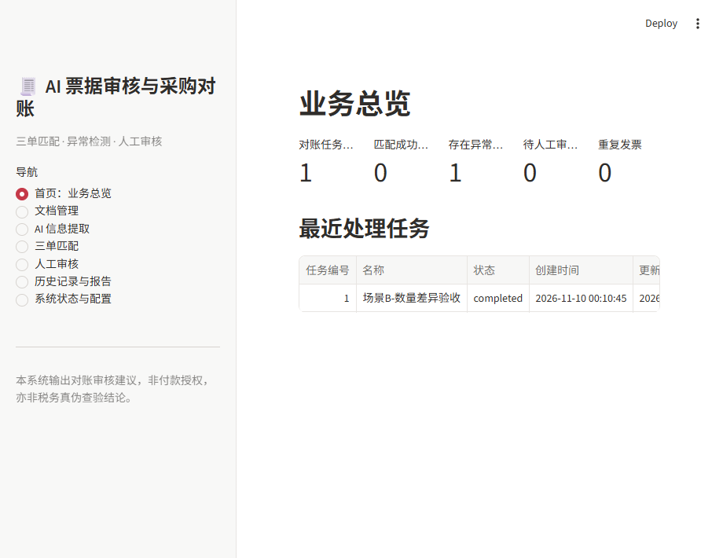
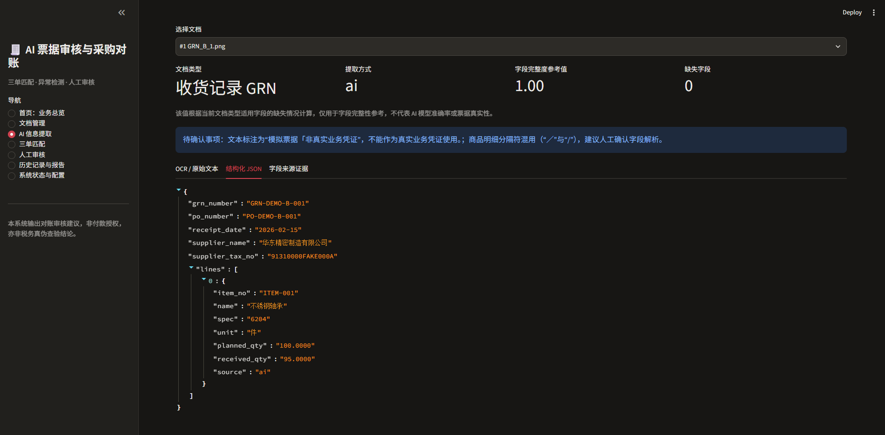
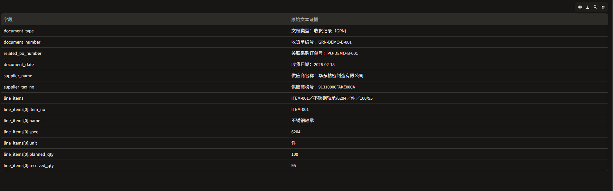
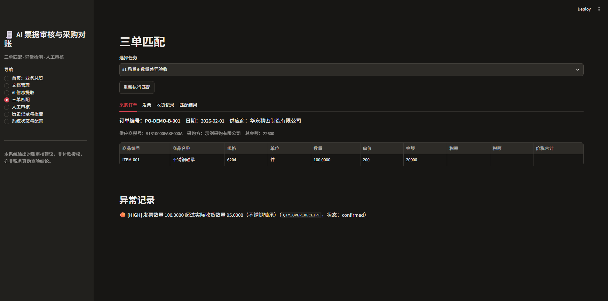
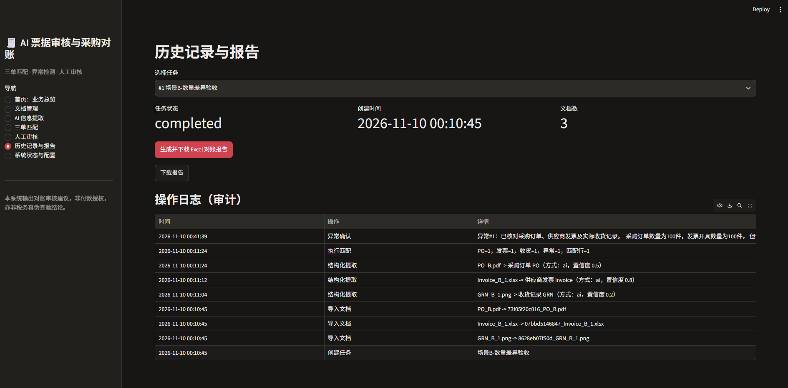

# AI 智能票据审核与采购对账系统

> AI Invoice Processing & Three-Way Matching System

面向企业采购与财务场景的自动化对账系统：上传采购订单（PO）、供应商发票（Invoice）、收货记录（GRN），系统自动完成文档识别、文本/OCR 提取、AI 结构化信息提取、数据标准化与验证、三单自动匹配、异常检测、人工审核，并生成可下载的 Excel 对账报告。

**重要声明**：本系统输出的是「对账审核建议」，不是付款授权，也不构成税务机关发票真伪查验结论。

---

## 一、业务背景

企业采购通常涉及三种单据，需要人工逐份核对：

| 单据 | 英文 | 作用 |
|------|------|------|
| 采购订单 | Purchase Order (PO) | 约定采购内容、数量、单价 |
| 供应商发票 | Invoice | 供应商开出的结算凭证 |
| 收货记录 | Goods Receipt Note (GRN) | 实际收到的商品数量 |

传统人工方式需要员工逐份查看、复制数据、手工计算。本系统将其自动化，并保留人工审核环节（Human-in-the-Loop），确保重大异常不会被自动放行。

---

## 二、核心能力

- 文档导入：支持 PDF / PNG / JPG / XLSX 批量上传，文件类型与大小校验、安全文件名、SHA-256 哈希去重。
- 文本提取：可搜索 PDF 直接取文本，扫描 PDF 转图片走 OCR，图片走本地 OCR，Excel 用 openpyxl 读取。
- 本地中文 OCR：默认 RapidOCR（自包含 ONNX 中文模型，兼容 Python 3.13）。
- AI 结构化提取：可配置 OpenAI-Compatible Chat Completions 接口（LLM_BASE_URL / LLM_API_KEY / LLM_MODEL），输出经 Pydantic JSON Schema 校验，失败有限重试，字段级原始文本证据。已实测 DeepSeek（`deepseek-flash`），发票字段验证 7/7。
- 离线演示模式：不配置 API Key 也能运行，使用本地规则解析随项目提供的模拟文档，明确标识提取方式（text / ocr / ai / offline / manual）。
- 数据标准化：中文标点、名称、单位、日期、税率统一，金额一律 `Decimal`，商品别名映射支持人工维护。
- 三单匹配：供应商核对、订单关联核对、商品匹配（编号优先）、数量核对（支持部分收货/分批开票）、单价/金额/税额核对、重复发票识别。
- 异常检测：区分数量差异、价格差异、金额差异、供应商不一致、重复发票、原始资料缺失、待人工确认等，逐条记录。
- 人工审核：查看原始文件/OCR/AI 结果、修正字段（保留修改前后值、时间、原因）、确认/驳回异常。
- SQLite 持久化：任务、文档、提取结果、业务单据、行明细、匹配、异常、审核、日志、别名，全部落库，可重开历史任务。
- Excel 报告：对账总览、PO/发票/收货明细、匹配结果、异常记录、审核历史，异常着色、自动筛选、冻结窗格。
- Web 界面：Streamlit 全中文界面，6 大功能页。

---

## 三、技术栈

| 层 | 技术 |
|----|------|
| 语言 | Python 3.13 |
| Web | Streamlit |
| PDF | PyMuPDF |
| OCR | RapidOCR（rapidocr-onnxruntime） |
| Excel | openpyxl |
| 图片 | Pillow |
| 结构化校验 | Pydantic v2 |
| LLM 适配 | requests（OpenAI-Compatible Chat Completions） |
| 数据库 | SQLite（标准库 sqlite3） |
| 测试 | pytest + pytest-cov |
| 配置 | python-dotenv（.env） |

> **OCR 选型说明**：需求建议优先评估 PaddleOCR。PaddleOCR 依赖 paddlepaddle，其在 Python 3.13 下 wheel 兼容性不稳定且体积较大；RapidOCR 使用与 PaddleOCR 相同的 PP-OCR 中文模型（转为 ONNX），自包含、轻量、对 Python 3.13 兼容良好，因此作为默认引擎。OCR 层为抽象接口，亦支持 `paddleocr` 与 `tesseract` 引擎（见 `.env.example` 的 `OCR_ENGINE`）。

---

## 四、目录结构

```
AI票据审核与采购对账系统/
├── app.py                     # Streamlit 入口
├── requirements.txt
├── pytest.ini
├── run.bat                    # Windows 一键启动
├── .env.example               # 配置模板（复制为 .env）
├── src/invoice_matching/
│   ├── config.py              # 集中配置与业务容差
│   ├── models.py              # 统一数据模型（Decimal）
│   ├── schemas.py             # Pydantic JSON Schema
│   ├── detection.py           # 文档类型识别
│   ├── document_import.py     # 导入/哈希/校验
│   ├── anomalies.py           # 异常模型
│   ├── db.py                  # SQLite 持久化
│   ├── review.py              # 人工审核
│   ├── report.py              # Excel 报告
│   ├── pipeline.py            # 端到端编排
│   ├── extraction/            # PDF/Excel/OCR 提取层
│   ├── ai/                    # LLM Provider、提取器、离线解析
│   └── processing/            # 标准化、别名、验证、匹配
├── scripts/generate_demo_data.py   # 生成演示数据
├── demo_data/                 # 7 组演示场景（脚本生成）
├── tests/                     # pytest（103 项，覆盖率 88%）
└── docs/                      # 文档
```

---

## 五、安装与启动

### 1. 创建虚拟环境并安装依赖

```bash
# 在项目根目录（包含 app.py 的目录）下执行
python -m venv .venv
.venv\Scripts\python.exe -m pip install --upgrade pip
.venv\Scripts\python.exe -m pip install -r requirements.txt
```

> Windows 下也可直接双击 `run.bat`，脚本会自动创建虚拟环境、安装依赖并启动界面。

### 2. 配置（可选）

复制 `.env.example` 为 `.env`，按需填写。不配置也能以「离线演示模式」运行。

```ini
# 启用真实 LLM 结构化提取（必须由用户主动开启）
LLM_ENABLED=1
LLM_BASE_URL=https://your-provider.example.com/v1
LLM_API_KEY=sk-xxxx
LLM_MODEL=your-model-name

# OCR 引擎：rapidocr（默认） / paddleocr / tesseract
OCR_ENABLED=1
OCR_ENGINE=rapidocr
```

> 真实 API Key 只放本地 `.env`，绝不写入代码或提交 Git。

### 3. 生成演示数据

```bash
.venv\Scripts\python.exe scripts\generate_demo_data.py
```

会在 `demo_data/` 下生成 7 组场景（PDF / PNG / XLSX，含「模拟票据｜非真实业务凭证」水印标注）。

### 4. 启动 Web 界面

```bash
.venv\Scripts\python.exe -m streamlit run app.py
```

浏览器访问 `http://localhost:8501`。

### 5. 真实 AI 调用（DeepSeek，已实测）

本项目已用真实 DeepSeek API 完成验收（`deepseek-flash`，发票字段验证 7/7）。真实调用由 `.env` 显式开启：

```ini
LLM_ENABLED=1
LLM_BASE_URL=https://api.deepseek.com
LLM_API_KEY=你的密钥
LLM_MODEL=deepseek-flash
```

独立冒烟测试脚本（使用完全虚构的发票文本，不读取真实票据）：

```bash
.venv\Scripts\python.exe scripts\smoke_test_llm.py
```

输出模型名、请求是否成功、Schema 是否通过、字段验证结果，**不会打印 API Key**。

### 6. 快速演示（3～5 分钟）

```bash
.venv\Scripts\python.exe scripts\generate_demo_data.py   # 生成 7 组虚构演示文件
.venv\Scripts\python.exe -m streamlit run app.py         # 启动
```

按 `docs/demo_script.md` 走一遍：导入 scenario_B → 真实 AI/OCR 提取 → 三单匹配（`QTY_OVER_RECEIPT`）→ 人工审核 → 导出 Excel 报告。

---

## 六、演示场景

`demo_data/` 下 7 组虚构场景（全部为虚构公司/供应商/商品数据）：

| 场景 | 说明 | 预期异常 |
|------|------|----------|
| A | 三单匹配一致（100/100/100） | 无 |
| B | 数量异常：发票 100 > 实收 95 | `QTY_OVER_RECEIPT` |
| C | 价格异常：PO 200 / 发票 220 | `PRICE_DIFF` |
| D | 重复发票：同一发票号码两张 | `DUPLICATE_INVOICE` |
| E | 供应商税号不一致 | `SUPPLIER_TAX_MISMATCH` |
| F | 金额计算错误（数量×单价 ≠ 金额） | `LINE_AMOUNT_MISMATCH` 等 |
| G | 缺失收货记录 | `ITEM_NO_GRN` |

### 场景 B 实测结果（2026-11-12，真实 DeepSeek）

- 三份文件 `PO_B.pdf` / `Invoice_B_1.xlsx` / `GRN_B_1.png` 经「真实 AI 结构化提取」（`method=ai`），其中 PNG 先经本地 RapidOCR 识别。
- 匹配结果：发票数量 100 vs 实收 95 → 命中 `QTY_OVER_RECEIPT`（HIGH）。
- 异常已通过「人工审核」确认，审核意见与时间落库（`review_records`）。
- 导出的 Excel 报告含 7 张工作表：对账总览、采购订单明细、发票明细、收货记录明细、三单匹配结果、异常记录、人工审核历史。

### 系统截图

系统实际运行界面截图（演示数据均为虚构）：

1. **业务总览**：任务、文档与整体处理状态一览。

   

2. **AI 信息提取**：展示文档类型、提取方式、字段完整度参考值、缺失字段提醒，以及 OCR/原文、结构化 JSON、字段来源证据三个标签页。

   

3. **字段来源证据**：AI 提取字段与原始文本片段对照，便于人工复核，保证可追溯。

   

4. **三单匹配**：PO / Invoice / GRN 三单核对结果与异常检测列表。

   

5. **人工审核历史**：字段修正与异常确认/驳回的审核留痕。

   

6. **Excel 对账报告**：可下载的对账报告汇总页。

   

---

## 七、测试

```bash
.venv\Scripts\python.exe -m pytest
.venv\Scripts\python.exe -m pytest --cov=invoice_matching --cov-report=term-missing
```

实测结果：**103 项测试全部通过，行覆盖率 88%**（详见 `docs/final_quality_audit.md`）。真实 LLM（DeepSeek）冒烟测试已通过（字段验证 7/7），另附 mock 测试覆盖 Provider 的异常/校验/重试/密钥保护逻辑。

---

## 八、局限性

1. **OCR 精度受图片质量影响**：竖线分隔符可能被识别为斜线，系统已做分隔符容错，但极端模糊/倾斜票据仍可能识别偏差，需人工复核。
2. **离线解析器面向模板**：离线模式对随项目提供的结构化格式可靠；对真实世界的异构票据格式，建议配置真实 LLM 或人工录入。
3. **演示版匹配粒度**：支持一张 PO 对应多条收货记录与多张发票（按商品聚合实收数量）；尚未实现跨 PO 的复杂拆分匹配。
4. **不做税务真伪查验**：系统不连接税务机关，发票号码/代码仅用于内部重复检查。
5. **单机本地运行**：SQLite 与文件均本地存储，未做多用户并发与权限隔离。
6. **不支持真实付款/报税/ERP 写入**：系统只输出审核建议。

---

## 九、安全与合规

- 不硬编码 API Key，不默认上传文件到外部 API，真实模型调用需用户主动启用。
- 上传文件校验类型与大小并安全保存；记录 SHA-256；重复文件明确提示。
- 不记录 API Key 与敏感票据全文到日志。
- 数据库与本地业务数据在 `.gitignore` 中，不提交 Git。
- 演示数据全部虚构，含「模拟票据｜非真实业务凭证」标注，不构成真实税务机关凭证。

详见 `docs/` 目录下各文档。
